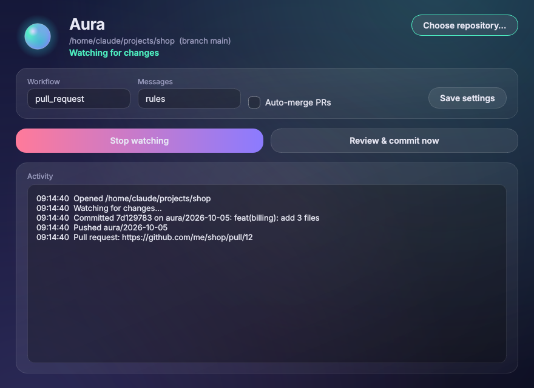
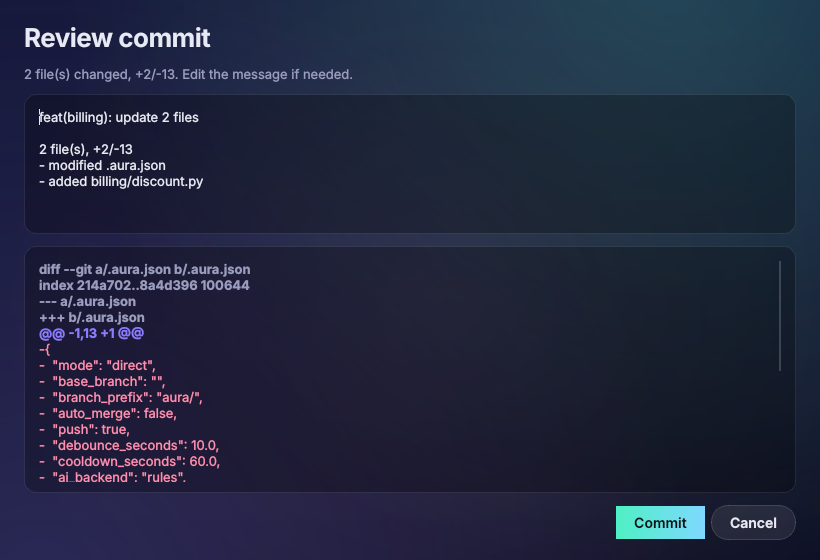
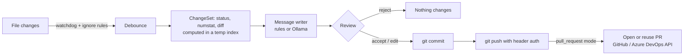

# Aura

[](https://github.com/Sandeepsrinivasan-14/Aura-App/actions/workflows/ci.yml)


[](LICENSE)

**Aura is a local Git assistant.** It watches a repository, waits until you stop editing, proposes a
[Conventional Commit](https://www.conventionalcommits.org/) message for the change, and, once you approve,
commits, pushes and opens (or updates) a pull request on **GitHub** or **Azure DevOps**.

It runs entirely on your machine. Commit messages come from a deterministic rule engine, or optionally from a
local LLM through [Ollama](https://ollama.com); no code is sent to a cloud AI service.

```text
$ aura status
Repository : C:\work\shop
Branch     : main
Mode       : direct
Remote     : https://github.com/me/shop.git [github]
API token  : found
AI backend : rules
Changes    : 2
  added     billing/invoice.py  +2/-0
  added     billing/tax.py  +2/-0

$ aura commit
2 changed file(s):
  added     billing/invoice.py  +2/-0
  added     billing/tax.py  +2/-0

Proposed commit message:
  | feat(billing): add 2 files
  |
  | 2 file(s), +4/-0
  | - added billing/invoice.py
  | - added billing/tax.py

Commit? [Y]es / [e]dit summary / [d]iff / [n]o: y
Committed 7d129783 on main: feat(billing): add 2 files
Pushed main to origin.
```

## Desktop app

| Main window | Review before every commit |
|---|---|
|  |  |

The app uses a dark "aurora glass" theme: translucent cards over a painted aurora background, and a
breathing status orb that changes colour as Aura works (violet when idle, teal while watching, rose while
committing, red after an error). The review dialog colours the diff (additions, removals, hunks) so you can scan a
change before approving it. A one-page product site lives in [`docs/index.html`](docs/index.html).

## Features

- **Debounced watching**: many quick saves become one proposal after a quiet period (default 10 s). Noise such as
  `.git/`, build output, logs and anything in `.gitignore` or `.auraignore` never triggers a commit.
- **Review before commit**: see the file list, full diff and proposed message; accept, edit or reject. A fully
  automatic mode (`--auto`) with a cooldown exists for solo scratch repositories.
- **Two workflows**:
  - `direct` commits and pushes to the branch you are on.
  - `pull_request` (default) moves your work to an `aura/<date>` branch, pushes it and opens a PR against the base
    branch. Later commits update the same PR. Optional squash auto-merge.
- **GitHub and Azure DevOps**, detected from the `origin` URL (HTTPS or SSH, including `*.visualstudio.com`).
- **Safe credential handling**: tokens come from environment variables or the OS keychain. They are passed to
  `git push` as an HTTP header through environment variables, never written into the remote URL, `.git/config`,
  the process argument list or error messages.
- **Previews don't touch your index**: diffs are computed in a temporary Git index, so partially staged work stays
  exactly as you left it.
- **CLI and desktop app** (PySide6), plus single-file Windows executables built by CI.

## Install

```bash
pip install "git+https://github.com/Sandeepsrinivasan-14/Aura-App.git"            # CLI
pip install "aura-git[gui,keyring] @ git+https://github.com/Sandeepsrinivasan-14/Aura-App.git"  # + desktop app, keychain
```

Requires Git on `PATH`. On Windows you can instead download `Aura.exe` and `aura-cli.exe` from the latest
[CI run](https://github.com/Sandeepsrinivasan-14/Aura-App/actions/workflows/ci.yml) or release.

## Usage

```bash
cd path/to/your/repo
aura init                     # writes .aura.json (no secrets; safe to commit)
aura login github             # or: aura login azure_devops   (stores the token in the OS keychain)
aura status                   # branch, remote, token and pending changes
aura commit                   # review and commit once
aura commit --dry-run         # show what would be committed and the message
aura commit -y -m "fix: x"    # non-interactive
aura watch                    # propose a commit every time edits settle
aura watch --auto             # commit without asking (respects cooldown)
aura gui                      # desktop app
```

### Tokens

| Provider | Environment variable | Required permission |
|---|---|---|
| GitHub | `GITHUB_TOKEN` or `GH_TOKEN` | Fine-grained token: *Contents* and *Pull requests* read/write on the repo |
| Azure DevOps | `AZURE_DEVOPS_PAT` or `AURA_AZDO_PAT` | PAT with *Code (Read & write)* |

Without a token Aura still commits and pushes using your normal Git credentials; it just can't open pull requests.

### Configuration (`.aura.json`)

| Key | Default | Meaning |
|---|---|---|
| `mode` | `"pull_request"` | `direct` or `pull_request` |
| `base_branch` | `""` | PR target; empty = the branch checked out when Aura starts |
| `branch_prefix` | `"aura/"` | Prefix for work branches |
| `auto_merge` | `false` | Squash-merge new PRs immediately |
| `push` | `true` | Set `false` to only commit locally |
| `debounce_seconds` | `10` | Quiet period before proposing a commit |
| `cooldown_seconds` | `60` | Minimum gap between automatic commits |
| `ai_backend` | `"rules"` | `rules` or `ollama` |
| `ollama_url`, `ollama_model` | `http://localhost:11434`, `mistral` | Local LLM settings |
| `ignore` | `[]` | Extra glob patterns to ignore |

Unknown keys are rejected, so a typo or a pasted secret fails loudly instead of being silently ignored.

### Local LLM messages (optional)

```bash
ollama pull mistral
# then set "ai_backend": "ollama" in .aura.json
```

Model output is accepted only if it is a valid single-line Conventional Commit summary. Otherwise, and whenever
Ollama is unreachable, Aura uses the rule-based message.

## How it works



```text
src/aura/
  agent.py           the workflow (cooldown, work branches, push, PR, auto-merge)
  git_ops.py         git CLI wrapper (temp-index previews, header auth, redaction)
  commit_message.py  rule-based and Ollama message writers
  providers/         GitHub and Azure DevOps REST clients, remote URL parsing
  watcher.py         debounced watchdog observer
  ignore.py          built-in, .auraignore, config and git check-ignore rules
  config.py          .aura.json and token lookup
  cli.py, gui.py     interfaces
  style.py           Qt theme, aurora background, animated status orb
tests/               51 tests against real temporary Git repos, a local bare "remote" and mocked APIs
packaging/           PyInstaller spec for Aura.exe and aura-cli.exe
```

## Development

```bash
pip install -e ".[dev,gui]"
pytest -q                       # QT_QPA_PLATFORM=offscreen on headless Linux
ruff check . && ruff format --check .
pyinstaller packaging/aura.spec --noconfirm   # builds dist/Aura and dist/aura-cli
```

CI runs the tests on Linux and Windows (Python 3.10 and 3.12) and builds the Windows executables; tagging `v*`
attaches them to a GitHub release.

## Limitations

- Only GitHub and Azure DevOps are supported for pull requests (any remote works for plain pushes).
- The rule-based writer describes *what* changed (files, type, scope), not *why*; review the summary before accepting.
- Pull-request mode leaves you on the work branch; switch back to the base branch yourself after the PR is merged.

## License

[MIT](LICENSE) © Sandeep Srinivasan
